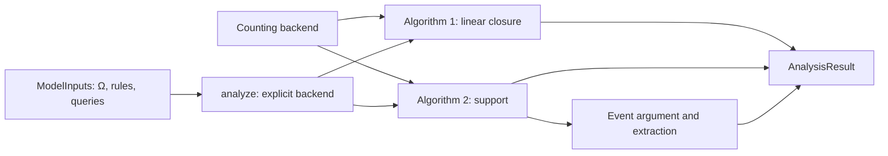

# Algorithms and counting

The tutorials declare Ω, rules and queries, then call the algorithms.
`ModelInputs` is data; execution always selects a backend explicitly.

`mfobs.core` contains the shared algorithms. `mfobs.models` contains bundled
example definitions and family-specific counting/event arguments. For each
large example, `inputs.py` defines Ω, rules and queries; `counting.py` reduces
computed patterns; `events.py` supplies the event argument. These are the
parts a new graph family may need to supply.

| Example | Python analysis | Ω, rules and queries | Count reduction | Event argument |
|---|---|---|---|---|
| ABA / query variation | [ABA](../../tutorials/aba_analysis.py), [five queries](../../tutorials/query_variation_analysis.py) | [Inputs](../../src/mfobs/models/aba/inputs.py) | [Paths, pools and suffixes](../../src/mfobs/models/aba/counting.py) | [Uniform source matches](../../src/mfobs/models/aba/events.py) |
| Molecular ROP | [ROP](../../tutorials/rop_analysis.py) | [Inputs](../../src/mfobs/models/molecular_rop/inputs.py) | [Whole units and local zero witnesses](../../src/mfobs/models/molecular_rop/counting.py) | [Chemical uniformity and shared suffix partition](../../src/mfobs/models/molecular_rop/events.py) |
| Chlorination | [Chlorination](../../tutorials/chlorination_analysis.py) | [Inputs](../../src/mfobs/models/chlorination/inputs.py) | [Transported NACs](../../src/mfobs/models/chlorination/counting.py) | [Joint per-match jump partition](../../src/mfobs/models/chlorination/events.py) |
| Rémy | [Rémy](../../tutorials/remy_analysis.py) | [Inputs](../../src/mfobs/models/remy/inputs.py) | [Typed trees](../../src/mfobs/models/remy/counting.py) | [All-tree context counts](../../src/mfobs/models/remy/events.py) |
| Eight sites | [Eight sites](../../tutorials/eight_slots_analysis.py) | [Manifest](../../examples/eight-slots/model.json) | [Cycle-completion identities](../../src/mfobs/models/eight_slots.py) | [Finite-language quotient](../../src/mfobs/models/eight_slots_common.py) |
| DNA walker | [DNA walker](../../tutorials/dna_walker_inspection.py) | [Inputs](../../src/mfobs/models/dna_walker/inputs.py) | [Scaffold extension identities](../../src/mfobs/models/dna_walker/counting.py) | — |
| Aldol | [Composition](../../tutorials/aldol_analysis.py) | [Literal rule](../../examples/tcs/aldol.gml) | [Local chemistry](../../examples/tcs/inputs.py); conditional composition with a separating host | — |
| Fixed ring | [Notebook](comparisons/ring8.ipynb) | [Manifest](../../examples/ring8/model.json) | [Ring counts](../../src/mfobs/models/ring.py) | [Finite quotient](../../src/mfobs/models/ring8_common.py) |
| Growing ring | [Notebook](../examples/11_growing_ring.ipynb) | [Manifest](../../examples/structural-nac-oscillator/model.json) | [Local word identities](../../src/mfobs/models/structural_nac_words.py) | No finite event closure certified |
| Brusselator–ROP | [Notebook](../examples/10_brusselator.ipynb) | [Chemical inputs](../../src/mfobs/models/brusselator_growth_chemistry.py) | [Population and path counts](../../src/mfobs/models/brusselator_growth_projection.py) | [Composition-derived events](../../src/mfobs/models/brusselator_pjc.py) |

| Paper step | Shared implementation |
|---|---|
| Algorithm 1 | [close_linear_span](../../src/mfobs/core/linear_closure.py): reduce rate-channel images in the current span and add residual coordinates. |
| Algorithm 2: support | [discover_support](../../src/mfobs/core/pattern_support.py): queue pattern factors found in `counter.activity(rule)` and `counter.image(pattern, rule)`. |
| Algorithm 2: uniform-match events | [extract_uniform_events](../../src/mfobs/core/uniform_events.py): derive jumps from images/activity and the backend's finite partition. |

The [graph tutorial](../../tutorials/graph_closure_tutorial.py) and the ABA and molecular ROP notebooks call the algorithms separately. Algorithm 1 uses [conditional compositions and count reduction](../../src/mfobs/core/counting_linear_closure.py), without Algorithm 2 or its events. Algorithm 2 discovers support and extracts events. Neither result is a prerequisite for the other.

Ω is declared per example. Chemical families share the theory in [state_space.py](../../src/mfobs/state_space.py). Counting identities and event arguments are family-specific; finite checks do not prove them. Unsupported reductions return UNKNOWN.

MolFoundry supplies matching, composition, condition transport and rule application. [engine.py](../../src/mfobs/core/engine.py) and [signed count reduction](../../src/mfobs/core/pattern_support.py) are shared. Independent reference checks live in [checks/](../../src/mfobs/checks); [numerical routines](NUMERICS.md) consume the resulting equations or events.

[Notebooks](../examples/README.md) · [Run and build](../../README.md)
